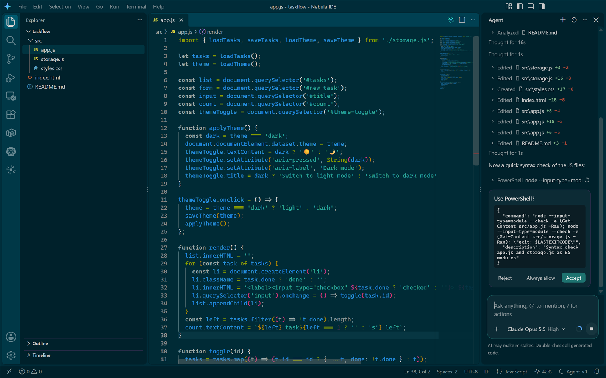
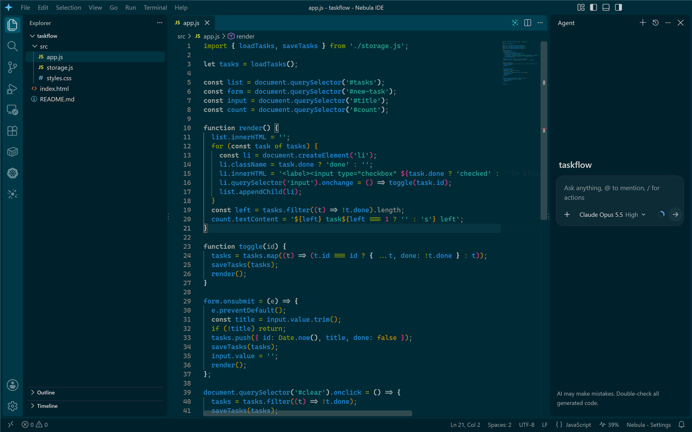
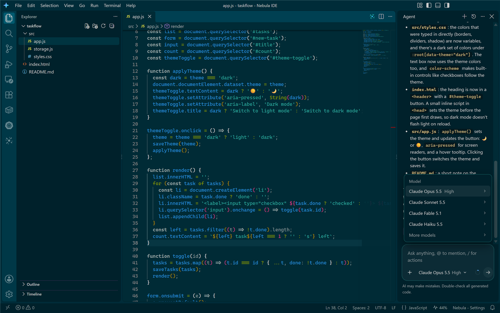
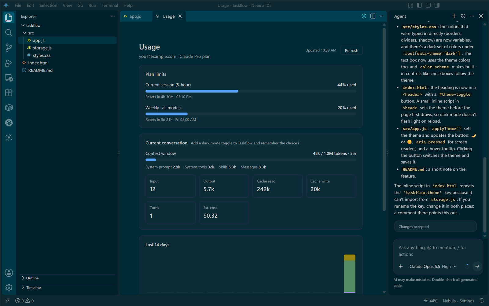
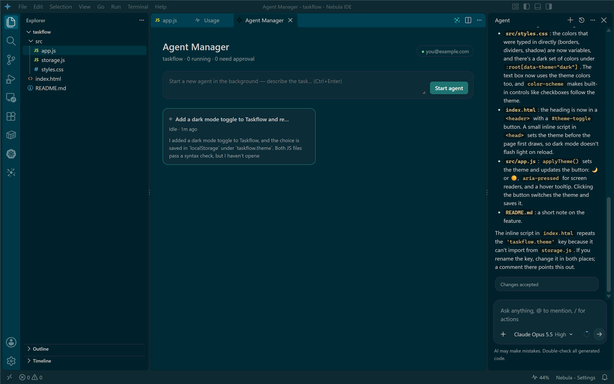

# Nebula IDE

An agent-first code editor in the style of Antigravity IDE, built on VSCodium (the open-source
build of VS Code) with Claude as the agent.



## Install

**One line (PowerShell):**

```powershell
irm https://raw.githubusercontent.com/dor2500/nebula-ide/main/install.ps1 | iex
```

It downloads the latest release, verifies its SHA-256 checksum, installs for the current user
(no admin rights) and starts Nebula IDE.

**Or download the installer** from the [latest release](https://github.com/dor2500/nebula-ide/releases/latest)
and run `Nebula-IDE-Setup-<version>.exe`. Silent install: `Nebula-IDE-Setup-<version>.exe /S`.

The installer adds Start menu and desktop shortcuts, "Open with Nebula IDE" in Explorer, and an
entry in Apps & features for uninstalling. On first launch, sign in with your Claude account
(Pro / Max) or an Anthropic API key, and optionally import your Antigravity extensions and settings.

## Screenshots

| | |
|---|---|
|  |  |
| **Agent panel** — opens on the right, like Antigravity | **Model picker** — the list comes live from Claude |
|  |  |
| **Usage** — plan limits, context window, token history | **Agent Manager** — run several agents in the background |

## What's inside

- **VSCodium 1.140** rebranded as Nebula IDE (own data folders, so it never touches VSCodium or Antigravity).
- **Nebula Agent** (built-in extension, `extension/`):
  - Agent panel on the right (`Ctrl+L`), new conversation (`Ctrl+Shift+L`), past conversations, Agent Manager (`Ctrl+E`), edit selection (`Ctrl+I`).
  - Composer with `+` Add Context (media, mentions, actions), `@` file mentions, `/` actions and a model + effort picker (`Ctrl+/`).
  - The model list and `/` actions come live from the Claude engine, so new models and commands appear automatically.
  - Change review: every edit is snapshotted; review as a diff, accept or reject per file or all at once.
  - Sign in with your Claude account (official Claude Code login) or an Anthropic API key.
  - The Claude engine updates itself: hourly check against npm, integrity-verified download, self-check, switch when idle.
  - **Usage**: status-bar meter for your plan's 5-hour limit, a context-window ring in the composer, and a Usage page
    (status bar, `…` menu or `Nebula: Usage`) with plan limits and reset times, the current conversation's context
    and tokens, and a 14-day token history per model.
  - One-click import of Antigravity extensions, settings, keybindings and snippets.
- **Open Remote - SSH** built in (Remote Explorer).
- Open VSX marketplace (the same one Antigravity uses).

## Build from source

Requires Windows, Node.js 20+ and PowerShell 7.

```powershell
pwsh -File build.ps1
```

Installs the extension's dependencies, downloads VSCodium (once), stages the branded app in
`%TEMP%\nb\Nebula IDE`, and writes `dist\Nebula-IDE-Setup-<version>.exe`. Use `-SkipInstaller` to only
stage the app. `makensis` (NSIS 3) and `rcedit` are taken from the electron-builder cache in
`%LOCALAPPDATA%\electron-builder\Cache`; if you don't have it, install NSIS 3 and point `$makensis` in
`build.ps1` at its `makensis.exe`.

## License

Nebula's own code is MIT. VSCodium is MIT-licensed; Open Remote - SSH is MIT-licensed. The Claude Agent SDK
is distributed under Anthropic's terms. Nebula is not affiliated with Google or Antigravity.
