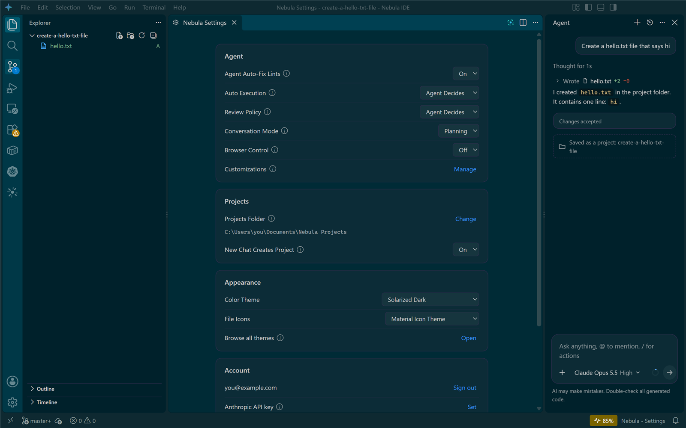

# Nebula IDE

An agent-first code editor in the style of Antigravity IDE, built on VSCodium (the open-source
build of VS Code) with Claude as the agent.


## Install

**One line (PowerShell):**

```powershell
irm https://raw.githubusercontent.com/dor2500/nebula-ide/main/install.ps1 | iex
```

It downloads the latest release, verifies its SHA-256 checksum, installs to `C:\Program Files\Nebula IDE`
(Windows asks for admin approval) and starts Nebula IDE. Nebula also checks for new versions itself and updates with one click.

**Or download the installer** from the [latest release](https://github.com/dor2500/nebula-ide/releases/latest)
and run `Nebula-IDE-Setup-<version>.exe`. Silent install: `Nebula-IDE-Setup-<version>.exe /S`.

The installer is a regular setup wizard: it installs for all users in Program Files, adds Start menu and
desktop shortcuts and "Open with Nebula IDE" in Explorer (optional), and registers in Apps & features /
Programs and Features with an uninstaller. On first launch, sign in with your Claude account
(Pro / Max) or an Anthropic API key, and optionally import your extensions and settings from
Antigravity, VS Code, Cursor or Windsurf.

## Screenshots

| | |
|---|---|
|  |  |
| **Agent panel** — opens on the right, like Antigravity | **Model picker** — the list comes live from Claude |
|  |  |
| **Settings** — review policies, auto-fix, projects, themes | **Usage** — plan limits, context window, token history |
|  | |
| **Agent Manager** — run several agents in the background | |

## Features

**Agent**
- Agent panel on the right (`Ctrl+L`), new conversation (`Ctrl+Shift+L`), past conversations, Agent Manager (`Ctrl+E`), edit selection (`Ctrl+I`).
- Composer with `+` Add Context (media, mentions, actions), `@` file mentions, `/` actions and a model + effort picker (`Ctrl+/`).
- **Images**: paste a screenshot (`Ctrl+V`), drag one in, or attach it — send it without a message and the agent works out what it is (a bug, a design, an error) and helps.
- **Review Policy** (file edits) and **Auto Execution** (terminal commands): *Always Proceed*, *Agent Decides* or *Request Review*. With *Agent Decides*, safe read-only commands (tests, builds, `git status`) run on their own and anything that deletes, installs, pushes or downloads asks first.
- **Auto-fix lints**: after the agent changes files, it fixes errors the language servers report in them.
- **Change review**: every edit is snapshotted; review as a diff, accept or reject per file or all at once.
- **Browser**: built-in browser (`Nebula: Open Browser`) and optional browser control for the agent (Playwright).
- **Generate commit message** from the Source Control view (✨ button).
- **Queued messages**: keep typing while the agent works — messages wait in line and go out when it finishes (or *Send now*).
- Planning / Fast conversation modes; rules (`CLAUDE.md`) and MCP servers under Customizations.

**Memory**
- The agent keeps notes for each project (and global notes) in `~\.nebula\memory` and reads them at the start of every conversation; it updates them itself when it learns something worth keeping.
- New conversations get a short summary of the project's recent conversations, so the agent knows what was done before.
- Start a message with `#` to save a note to memory yourself (`# global …` for all projects).
- Nebula opens on your recent conversations — click one to continue it, even from another project.

**Projects**
- Every project lives in `Documents\Nebula Projects` (change it in Settings).
- With no folder open, just describe what you want — the chat gets its own project folder and opens it, conversation included.
- **New project** from templates: empty, web page, Node.js or Python (with README, `.gitignore` and a git repo).

**Claude**
- Sign in with your Claude account (official Claude Code login) or an Anthropic API key.
- The model list and `/` actions come live from the Claude engine; the engine updates itself every hour, so new models and features arrive without reinstalling.
- **Usage**: status-bar meter for your plan's 5-hour limit, a context-window ring in the composer, and a Usage page with plan limits, reset times, conversation context and a 14-day token history.

**Other models (when Claude runs out)**
- **Local models** via Ollama are detected automatically and run free on your computer.
- Add **OpenRouter, OpenAI, Gemini, DeepSeek, Groq, Mistral, xAI, LM Studio** or any OpenAI-compatible service in Settings → Models; their models appear in the model menu.
- When your Claude limit is reached, Nebula asks which model to continue with (or switches automatically if you choose), and warns you at 90% of the 5-hour limit.
- Other models run through a built-in translation layer, so the same agent, tools and change review work with them. Small local models are fine for simple tasks; for real work use a strong cloud model.

**Look and feel**
- Antigravity-style layout: agent panel on the right, "Code with Agent" start screen, colored file icons.
- Themes: Nebula Dark, Nebula Midnight, Nebula Light, plus Dracula, One Dark Pro, Catppuccin, GitHub, Tokyo Night, Gruvbox Material and Nord built in. Material Icon Theme for file icons.
- Import extensions, settings, keybindings and snippets from Antigravity, VS Code, Cursor, Windsurf or VSCodium.
- **Open Remote - SSH** built in (Remote Explorer); Open VSX marketplace (the same one Antigravity uses).

Not included: Antigravity's "Tab" inline autocomplete — a Claude subscription has no low-latency
completion endpoint, so every keystroke would be a full agent request.

## Build from source

Requires Windows, Node.js 20+ and PowerShell 7.

```powershell
pwsh -File build.ps1
```

Installs the extension's dependencies, downloads VSCodium and the bundled Open VSX extensions (once),
stages the branded app in `%TEMP%\nb\Nebula IDE`, and writes `dist\Nebula-IDE-Setup-<version>.exe`.
Use `-SkipInstaller` to only stage the app. `makensis` (NSIS 3) and `rcedit` are taken from the
electron-builder cache in `%LOCALAPPDATA%\electron-builder\Cache`; if you don't have it, install NSIS 3
and point `$makensis` in `build.ps1` at its `makensis.exe`.

## License

Nebula's own code is MIT. VSCodium, Open Remote - SSH, Material Icon Theme and the bundled themes are
MIT-licensed. The Claude Agent SDK is distributed under Anthropic's terms. Nebula is not affiliated with
Google or Antigravity.
